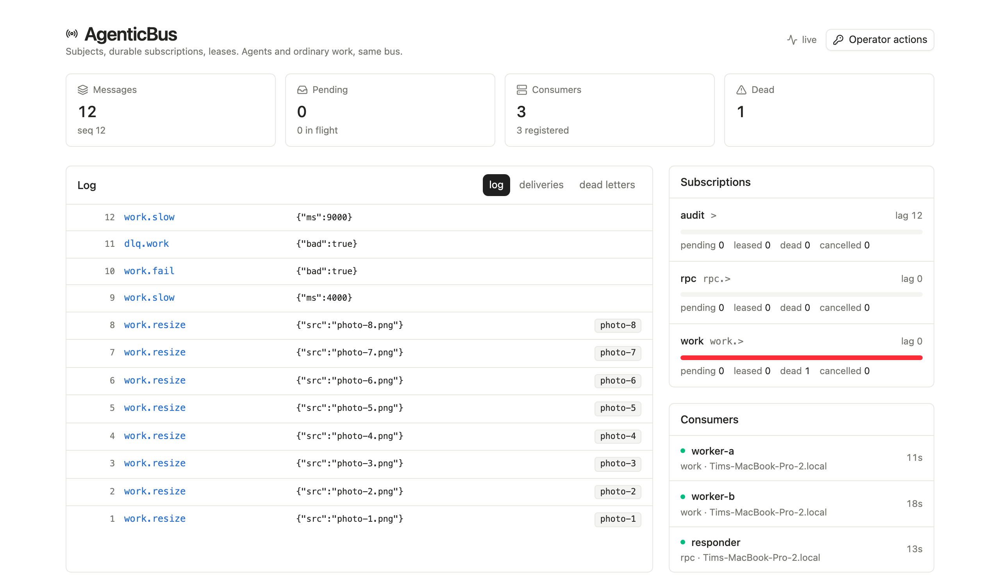

# bql.sh/bus

A durable message bus for agents and ordinary work. Bun, SQLite, no runtime dependencies.

Publish to a subject; durable subscriptions deliver to consumers with leases, retries, ordering and a dead-letter path. Nothing in the core knows what an agent is — agent patterns are conventions over subjects, which is what keeps a plain background job queue a first-class use rather than an afterthought.

```sh
bql bus serve &
bql bus subscribe work 'work.>'
bql bus consume work --exec ./handle.sh &
bql bus publish work.resize '{"src":"a.png"}'
```

Three things at once, from one set of primitives:

| | |
| --- | --- |
| **Work queue** | Competing consumers on one subscription, at-least-once, leases and fencing |
| **Pub/sub** | Many subscriptions on one subject, each with its own cursor, so a message fans out |
| **Request/reply** | A durable response addressed by correlation — ask now, collect after a restart |

## Install

Bun 1.4 or newer.

The bus is a subpath of one package, `bql.sh`, and its binary is `bql bus`. Installing the package
installs both halves; nothing here requires the database.

```sh
bun add bql.sh
bunx bql bus serve &
bunx bql bus subscribe work 'work.>'
bunx bql bus publish work.resize '{"src":"a.png"}'
```

The package ships the library, the `bql bus` command and the built dashboard, so `serve` has a
UI with nothing else to install.

**Working on the bus itself** runs it from source instead. It lives in the bql.sh monorepo
alongside [`bql.sh`](../db) — see [docs/monorepo.md](../../docs/monorepo.md) for why:

```sh
git clone https://github.com/TimMikeladze/bql && cd bql
bun install                # the whole workspace, one lockfile

bun run bus build          # the library bundle and the dashboard
bun run bus dev
bun run bus test
```

`bun run bus <script>` forwards from the repository root to this package. From inside
`packages/bus`, every script still runs by its own name — `bun run build`, `bun run dev`.

`bun run dev` starts the bus, three consumer processes and the dashboard, choosing free ports rather than fighting for taken ones.

```sh
bun src/cli/index.ts publish work.slow '{"ms":2000}'
bun src/cli/index.ts request rpc.upper '"hello"'
bun src/cli/index.ts stats
```



**The dashboard is read-only until you hand it a token.** The one the bus injects is a `reader`
token — a page that can be opened is not a page that can dispatch work. Pausing, replaying,
purging and requeueing appear once you paste an admin token into **Operator actions**, which is
kept in `sessionStorage` and dies with the tab.

## Subjects

Dot-separated tokens. `*` matches exactly one token, `>` matches one or more trailing tokens — the NATS convention, because people already know it.

```
orders.eu.created        a concrete subject
orders.*.created         matches orders.eu.created, not orders.eu.west.created
orders.>                 matches both
>                        everything
```

## Fan-out happens on pull, not on publish

A subscription holds a cursor into the log. When a consumer asks for work, the bus reads forward from that cursor and creates deliveries for the messages that match.

Three consequences worth knowing:

- **Publishing is O(1)** in the number of subscriptions. Adding the fiftieth subscriber costs producers nothing.
- **A subscription created today can read last week**, with `deliverFrom: "beginning"` or any sequence number.
- **A wall of unrelated subjects cannot starve a subscription.** The cursor advances past messages it examined and did not match, so they are never looked at again. Matching *after* a `LIMIT` — the obvious implementation — is a liveness bug that only appears once you have more than a couple of subjects.

## Delivery

At-least-once by default, with **three named tiers of exactly-once** available on top —
[docs/exactly-once.md](docs/exactly-once.md) is the whole story, and the short version is below.

- A delivery is leased to one consumer for the subscription's `ackWaitMs`, with a monotonic `generation`. An ack or nack from a stale generation is rejected.
- An expired lease returns the delivery to the queue for another consumer, up to `maxAttempts`.
- Exhausting attempts **dead-letters onto an ordinary subject** (`dlq.<subscription>` by default) with the reason in the headers — so a DLQ is just another subscription, and a replay is just another publish. `bql bus dlq <subscription>` lists them and `dlq requeue <seq>` republishes one onto the subject it failed on, with the `dlq-*` headers stripped and `requeued-from` added. A requeued message is an ordinary new message with its own sequence number: if it fails again it dead-letters again, which is the honest outcome.
- `dedupeKey` is unique per workspace: publishing the same key twice returns the first message, and a deduplicated *request* is handed back the original correlation, so it waits on the answer that will actually arrive.
- Every envelope carries `idempotencyKey` (`<subscription>:<seq>`), stable across redeliveries, and `fence` (`<deliveryId>:<generation>`), which identifies *this attempt* — so a destination with a conditional write can reject a writer whose lease has moved on.
- **Retries are paced.** Per-subscription `backoff` with full jitter, applied on a nack *and* on a reclaimed lease. Full jitter rather than equal jitter, because the failure mode is a fleet retrying in lockstep.
- **Priority classes** (−2…2) and **delayed publish** (`delayMs` / `deliverAt`) — scheduled work and retry-later without a second system.
- **`maxInFlight`** caps what one subscription can have leased, so a misconfigured `prefetch` cannot take the whole backlog into a process that is about to die.
- **Poison quarantine**: a subscription whose dead rate crosses a threshold pauses itself and says so, instead of finishing the backlog into the DLQ at full speed.

**Exactly-once, in three tiers.** End-to-end exactly-once against an arbitrary external system is
not achievable and is not claimed. What is:

| Tier | Guarantee | Requires |
| --- | --- | --- |
| **Transactional ack** | Exactly-once *processing* — the handler's writes and the ack are one SQLite transaction | Embedded mode (`createBus`), a synchronous handler |
| **Atomic read-process-write** | Exactly-once *within the bus* — `ack(id, { publish: [...] })` commits both or neither | Nothing; it is an option on `ack` |
| **Fenced, ledgered effects** | Tight effectively-once against the outside world | A destination with a conditional write, or an idempotent one |

The first exists *because* of the single-writer design, not despite it. The third leaves one
window — a crash between "the external call succeeded" and "the result was recorded" — which is
[named and not hidden](docs/exactly-once.md#the-window-this-does-not-close).

An ack is also **idempotent for the consumer that made it**: a retry after a lost response
replays the original outcome instead of answering 409, which is how a lost response stops being a
duplicated side effect.

**Ordering.** `ordered: true` means only the *head* of a key may be leased — not merely "nothing
leased for this key", which let a message that was waiting out its retry backoff be overtaken by
the next one. Per-key FIFO, with unrelated keys still moving in parallel. Off by default, because
ordering costs throughput and most work does not need it.

When an ordered key's message dead-letters, `onFailure: 'block'` (the default) **stalls that key
and only that key** until an operator requeues or skips it. Letting the next message through is
exactly the reordering `ordered: true` was bought to prevent. `bql bus blocked <subscription>`
lists them; `unblock` or `dlq requeue` releases one.

**Cancellation.** `bql bus cancel <seq>` stops a message: every unfinished delivery of it moves to a fourth terminal status, `cancelled`, and no subscription will create a new one — including a subscription whose cursor has not reached it yet.

A consumer already running the work learns on its **next lease renewal**, which answers `{cancelled: true}` rather than failing. `BusConsumer` aborts the handler's `signal`, and `--exec` passes that signal to the child process, so the work actually stops rather than a row merely changing colour. Cancelled deliveries are neither acked nor nacked and are never retried.

Cancelling is the **publisher's** call, or an admin's — the bus records which token published each message. A consumer cannot cancel its own work, because a consumer that could make a message it disliked disappear is a very quiet way to lose work.

## Schedules

Cron on the bus: a schedule is a standing publish that the existing one-second sweep fires on the
leader. No second scheduler, no second store — a fire is an ordinary message on an ordinary subject.

```sh
bql bus schedule add nightly '30 2 * * *' reports.nightly '{"kind":"daily"}' --tz America/New_York
bql bus schedule list            # --json for machines
bql bus schedule run nightly     # fire once now; does not move the next fire
bql bus schedule pause nightly · resume nightly · remove nightly
```

```ts
await bus.putSchedule({ name: "nightly", cron: "30 2 * * *", tz: "America/New_York",
  subject: "reports.nightly", body: { kind: "daily" }, catchUp: "latest" });
```

- **Five fields** — `*`, lists, ranges, steps (`*/15`, `5/15`), month and day names, `7` as Sunday —
  plus `@hourly` `@daily` `@weekly` `@monthly` `@yearly`. Day of month and day of week follow Vixie
  cron: both restricted means *either* matches, and a `*`-led field turns that back into *and*.
  A bad expression, an unknown zone or one that can never fire (`0 0 31 2 *`) is a 400 that says why.
- **Time zones are IANA names** (`tz`, default `UTC`) and DST follows Vixie cron. A job whose
  minute or hour starts with `*` (`*/15 * * * *`, `@hourly`) runs on real time: it fires in both
  passes of a repeated hour and has no fires in skipped minutes. A fixed time (`30 1 * * *`) the
  clocks skip fires once at the first valid minute after the gap, and one that happens twice fires
  once, the first time.
- **Exactly one message per slot.** Each fire publishes with `dedupeKey = schedule:<name>:<fireAtMs>`
  in the same transaction that moves `nextAt`, so a double sweep finds nothing due, and a promoted
  follower whose schedule row lags the log re-derives the same key and gets the existing message
  back. Every fire carries `schedule-name` and `schedule-at` (the scheduled instant, ISO) headers.
- **`catchUp`** decides what a bus that was down does about the slots it missed: `latest` (the
  default) fires once for the most recent one — never a burst — and `none` skips them. A fire more
  than a minute late counts as missed under `none`.
- **Pausing** clears `nextAt`; resuming computes it from now, so paused slots are not caught up.
  A fire that cannot publish (quota, disk, an enforced schema) stays due, is retried with backoff
  (`retryAt`: 2 s doubling to 5 min), and puts the reason in `lastError`.
- **Scopes.** Defining, pausing and removing a schedule is admin, like a subscription. Reading is a
  reader. `run` is a publish: admin, or any token allowed to publish to the schedule's subject, and it
  counts against the publish rate limit.
- **Replication.** A follower mirrors the schedule rows alongside the cursors and never fires; the
  leader only fires while it holds the write fence.

## Schemas

A registry of JSON Schema 2020-12 documents, bound to subject *patterns*, with an own validator —
no `ajv`, because the bus ships as one binary with no runtime dependencies.

```sh
bql bus schema register order ./order.json --compat backward
bql bus schema bind 'orders.>' order --mode warn      # then --mode enforce
bql bus schema check order ./order-v2.json            # dry-run the compat check
```

Two decisions carry the feature:

- **Registration rejects any keyword the validator does not implement.** A validator that quietly
  ignores `if`/`then` reports a document as valid when the rule the author wrote was never
  checked. A loud gap beats a quiet hole. `GET /api/schemas/keywords` lists what this build
  enforces.
- **Compatibility is computed, not documented.** `backward | forward | full | none`, checked
  structurally at registration against the previous version — a newly required property, a
  narrowed type, a shrunk enum, a tightened bound. Registering a version that breaks the declared
  mode is a 409 naming the pointer. Schemas without compat checking are paperwork.

`warn` publishes and stamps `schema-invalid` on the envelope, so a schema can be introduced
against live traffic. `enforce` answers 422 with the failing JSON Pointer. A message already in
the log cannot be un-published, so a delivery that fails an enforced schema **dead-letters** with
`dlq-reason: schema` — the only correct move once the write has happened.

Full details, including the keyword list: [docs/schemas.md](docs/schemas.md).

## Storage

The bus keeps its tables in one bql.sh database, `bus`. `--data` is bql.sh's data directory, and
the bus keeps its own keys in `bus/` inside it:

```
.bql-bus/                 --data (BUS_DATA), default .bql-bus
  _system.db              bql.sh's catalog
  keys.json               bql.sh's own keys
  dbs/…/bus/              database "bus": main.db, its WAL, its log
  bus/keys.json           the bus's signing keyring (0600)
  bus/admin-token         the bus's admin token (0600)
```

`bql bus serve`, `bql bus serve --cluster` and `bql serve --bus` all use this layout. `--database`
(or `BUS_DATABASE`) names another database than `bus`:

```sh
bql bus serve --data ./bus-data
bql bus serve --data ./bus-data --database orders-bus
```

Every write the bus makes (publish, claim, ack, renew, the sweep, the scheduler, migrations)
commits through the tenant's write path and lands in its log, which is what replication, S3
shipping and point-in-time restore read. The tenant owns checkpoints, and foreign keys are
switched on for the database when the bus opens it. Bodies over 64 KiB go to a `blobs_data`
table in the same database, written in the same transaction as the message row, so a replica and
a backup carry them. The schema is versioned in `schema_version`; a database written by a newer
build is refused rather than guessed at.

A single node runs `Bql.open` on `--data` and serves only the bus, at the root of `--port`; no
bql.sh listener is opened, so nothing else writes database `bus`. `--config bql.toml` passes any
other bql.sh setting, such as `[s3]`.

Embedded, pass the engine:

```ts
import { Bql } from "bql.sh"
import { createBus, ensureBusDatabase } from "bql.sh/bus"

const bq = await Bql.open({ dir: "./data" })
await ensureBusDatabase(bq)                 // creates "bus" if missing, foreign keys on
const bus = createBus({ bql: bq })          // { database: "bus", ack: "fsync" } are the defaults
```

`consumeTransactional` commits the handler's writes and the ack as one bql.sh write. Inside the
handler bql.sh refuses `BEGIN`/`COMMIT`/`ROLLBACK`, connection pragmas and `ATTACH`;
`db.transaction()` still nests as a savepoint. bql.sh answers a write that arrives while a
snapshot holds its writer with `BUSY` rather than waiting, so the bus retries it after a short
sleep (publish, claim and ack inside the store, every other route at the HTTP boundary). A request
that had already committed a write before hitting `BUSY` answers `503 {"code":"BUSY"}` with
`Retry-After: 1` instead of running twice.

A single-row write costs more here than it did on a plain SQLite file, because every commit is
captured into the replicated log. `publishBatch` is one commit and one log record for the whole
batch, which is the lever for publish-heavy producers.

## Durability

- **Publishes take an ack level**, bql.sh's four: `local` (committed), `fsync` (on this machine's
  disk, the default), `replica` (and on at least one replica), `quorum` (on a majority). Set the
  server default with `--ack` (or `BUS_ACK`) and override it per request:

  ```sh
  curl -X POST localhost:4317/api/publish -H "Authorization: Bearer $ADMIN" \
    -d '{"subject":"orders.eu.created","body":{"id":1},"ack":"fsync"}'
  # {"seq":1,"id":"…","duplicate":false,"correlation":null,"txid":12}
  ```

  `client.publish({ …, ack })`, `client.publishBatch(messages, { ack })` and an ack that publishes
  (`ack(delivery, id, { publish, ack })`) take it too. The answer carries the bql.sh `txid` the
  message committed in. `replica` and `quorum` are checked before anything is
  written: with no replica attached the publish answers `503 {"code":"NO_REPLICAS"}` and nothing
  is in the log. `503 {"code":"ACK_TIMEOUT","seq":…,"txid":…,"acks":…,"needed":…}` means the
  message committed and is durable here but the replicas didn't ack in time; publishing it again
  would publish it twice, so read it back by `seq` or use a `dedupeKey`. Plain acks, nacks and
  renewals wait for nothing beyond their own commit (`local` under `--ack local`, `fsync`
  otherwise). A single node has no replica, so `replica` and `quorum` there are always
  `NO_REPLICAS`.
- **Large bodies are checked on read.** A body in `blobs_data` has `body_sha256` and `body_bytes`
  on its message row. A body that does not match is an error naming the handle, never a
  half-message handed to a handler.
- **A message whose body is gone dead-letters** instead of failing every claim forever. The
  startup scan reports how many; the claim path handles the rest.
- **The WAL is bql.sh's to checkpoint.** `bql_bus_wal_bytes` and `bql_bus_db_bytes` are gauges.
- **A nearly full disk is a policy, not undefined behaviour.** Below the watermark `/api/publish`
  answers **507** with a machine-readable reason and `/ready` goes 503 — while claims and acks keep
  working, because a full disk is exactly when consumers need to drain.
- **Backup is bql.sh's S3 shipping, restore is `bql restore`.** With `[s3]` in `--config` or
  `BQL_S3_URL` in the environment, `bql bus serve` ships database `bus` to the bucket as it
  commits, and SIGTERM ships what is outstanding before it exits. `bql restore bus --from s3://…
  --at <txid|time>` rebuilds it into another data directory; [docs/operations.md](docs/operations.md#backup-and-restore)
  has the commands. `bun run drill:restore` does the whole round trip and compares the log, the
  cursor and a large body.

## Observability

- **W3C `traceparent` end to end.** A publish that arrives without one starts a trace; every
  message carries it in its headers, and a reply or an `api.emit` continues it. A message crossing
  three consumers is one trace rather than three unrelated ones.
- **An OTLP/HTTP exporter in one ~200-line file**, behind `--otlp-endpoint`, written rather than
  depended on — the wire format is a public specification and `fetch` is built in. Fire-and-forget: a collector that is down costs dropped spans and a log line,
  never a 500.
- **Histograms that answer the real question**: publish and ack latency, **delivery age at claim**
  and **end-to-end age at ack**. Age is the number that says the bus is behind; a fast claim of an
  hour-old message is still an hour late.
- **Gauges**: per-subscription lag, DLQ depth, in-flight, oldest pending age; WAL, database and
  free-disk bytes; replication lag.
- **`/metrics` is no longer admin-only.** Admin scrapes the install; a workspace-pinned **reader**
  token gets only its own workspace's series and none of the install-wide disk numbers.

## Writing a consumer

```ts
import { BusClient, BusConsumer, FatalError } from "bql.sh/bus/client";

const client = new BusClient({ url: "http://127.0.0.1:4317", token: process.env.BUS_TOKEN! });

await new BusConsumer({
  client,
  id: "resizer-1",
  subscription: "work",
  prefetch: 4,
  async handle({ message }, api) {
    if (!supported(message.body)) throw new FatalError("unsupported format");
    await api.extend();               // renew the lease from a long handler
    return { ok: true };              // a returned value answers a request
  },
}).start();
```

Return normally and the message is acked. Throw and it is nacked, retried with the subscription's
backoff, and eventually dead-lettered. Throw `FatalError` to dead-letter immediately, because a
message this consumer can never handle should not be tried four more times.

The handler API also carries the exactly-once machinery:

```ts
async handle({ message }, api) {
  // Committed with the ack, not before it: a crash cannot produce this message
  // without also finishing the one that caused it.
  api.emit({ subject: "thumbnails.ready", body: { id: message.body.id } });

  // At most once, with the result recorded alongside the ack. A redelivery
  // replays it instead of charging the card again.
  const charge = await api.effect(`charge:${message.body.orderId}`, () =>
    payments.charge(message.body),
  );

  // This attempt, for a conditional write at the destination.
  await store.put(key, bytes, { ifMatch: api.fence });
}
```

**Shutdown hands work back.** `consumer.stop()` aborts in-flight handlers and nacks their
deliveries with *no* delay, so another consumer picks them up at once. Letting the leases expire
instead costs one `ackWaitMs` of dead time per in-flight message on every deploy, for nothing.

Set `handlerTimeoutMs` (or `--exec-timeout`) on anything that could hang. The loop renews the lease for as long as a handler is pending, so the mechanism that protects slow work protects stuck work just as well — without a timeout, a wedged handler holds its message indefinitely.

If the message carried a `reply-to`, whatever the handler returns becomes its response — an RPC consumer is an ordinary consumer that happens to return a value.

**Embedded mode** is the other direction: the bus in your own process, no socket, and the handler
writing to the same database as the ack, which is what makes the ack transactional.

```ts
import { Bql } from "bql.sh";
import { createBus, ensureBusDatabase } from "bql.sh/bus";

const bq = await Bql.open({ dir: "./data" });
await ensureBusDatabase(bq);
const bus = createBus({ bql: bq });
bus.store.raw().run("CREATE TABLE IF NOT EXISTS processed (seq INTEGER PRIMARY KEY)");

bus.consumeTransactional({
  subscription: "work",
  // Synchronous, and that is load-bearing: an `await` in here would let another
  // statement interleave into the transaction this exists to provide.
  handle: (envelope, db) => {
    db.run("INSERT INTO processed (seq) VALUES (?)", [envelope.message.seq]);
  },
});
```

**In any other language**, `--exec` is the whole integration: the message arrives on stdin, and stdout becomes the reply.

```sh
bql bus consume work --exec ./resize.sh --prefetch 4
```

## Sinks

A sink is a consumer that writes **batches** somewhere else — a webhook, a bucket, ClickHouse — and
acks only once the destination accepted the batch. A destination that is down turns into nacks,
so the subscription's own retry, backoff and dead letter apply; nothing is acked into nowhere.

```sh
bql bus sink webhook    --subscription cdc --subject 'db.>' --to https://example.com/hook --secret "$SECRET"
bql bus sink s3         --subscription lake --bucket events --prefix cdc/ --endpoint-url https://…
bql bus sink clickhouse --subscription olap --to http://clickhouse:8123 --table analytics.users --shape row
```

`--subject` creates the subscription first (or confirms it). A batch is written at `--batch`
messages (default 500) or once its oldest message has waited `--flush-ms` (1000; 10000 for s3),
and every lease it holds is renewed while it waits.

| Sink | Writes | Notes |
| --- | --- | --- |
| `webhook` | `POST` a JSON array of `{seq, subject, key, publishedAt, idempotencyKey, body}` | `--secret` signs it: `x-bql-signature: t=<ms>,sha256=<hex>` over `<t>.<body>`; `verifyWebhookSignature` checks it. Non-2xx nacks |
| `s3` | one gzipped NDJSON object per batch, same records, via `Bun.S3Client` | key `<prefix><yyyy>/<mm>/<dd>/<hh>/<time>-<firstSeq>.ndjson.gz`; credentials from `S3_*` / `AWS_*` |
| `clickhouse` | `INSERT INTO <table> FORMAT JSONEachRow`, one line per message | `--shape body` (default) the body as is; `--shape row` for db outbox changes — unwraps `row` (`old`/`pk` for a delete) and adds `_op`, `_db`, `_table`, `_txid`, `_seq`, `_i`, `_committed_at`; `--shape record` the whole record. `input_format_skip_unknown_fields=1`, so a shape that does not fit the table inserts defaults — pick the one that does. `CLICKHOUSE_PASSWORD` |

At-least-once, like every consumer: a crash between the write and the acks writes the batch again.
Every record carries `idempotencyKey` for a destination that dedupes. Paired with the database's
outbox (`[outbox]` in [bql.sh](../db/README.md)), this is committed rows to a webhook or a
warehouse with no code. In a program, `SinkRunner` with `webhookSink`, `s3Sink` or `clickhouseSink`
is the same loop:

```ts
import { BusClient, SinkRunner, webhookSink } from "bql.sh/bus";

await new SinkRunner({
  client: new BusClient({ url: "http://127.0.0.1:4317", token: process.env.BUS_TOKEN! }),
  id: "hook-1",
  subscription: "cdc",
  writer: webhookSink({ url: "https://example.com/hook", secret: process.env.HOOK_SECRET }),
}).start();
```

## CLI

| | |
| --- | --- |
| `bql bus serve` | run the bus |
| `bql bus token --consumer id --publish 'a.>' --subscribe work` | mint a scoped token |
| `bql bus publish <subject> <json>` | publish |
| `bql bus request <subject> <json>` | publish and wait for a reply |
| `bql bus subscribe <name> <pattern>` | create a durable subscription |
| `bql bus consume <subscription> --exec CMD [--exec-timeout ms]` | run a consumer |
| `bql bus sink webhook\|s3\|clickhouse --subscription name [--subject pattern]` | batch a subscription into another system |
| `bql bus cancel <seq>` | stop a message; in-flight handlers abort |
| `bql bus dlq <subscription>` · `dlq requeue <seq…>` | inspect and requeue dead letters |
| `bql bus blocked <subscription>` · `unblock <sub> <key>` | ordered keys stalled behind a dead letter |
| `bql bus schedule add <name> <cron> <subject> [json]` · `list` · `show` · `remove` · `pause` · `resume` · `run` | cron schedules (`--tz`, `--catch-up`, `--json`) |
| `bql bus schema register <name> <file>` · `check` · `bind` · `list` | the registry |
| `bql bus keys rotate` · `keys retire <kid>` | signing keys, with an overlap window |
| `bql bus revoke <jti>` · `quota [set]` · `audit` | tenant safety |
| `bql bus serve --cluster --node n1 --peers n2=ws://…,n3=ws://… --port 4321` | one node of a clustered bus, under `/bus` ([Boundaries](#boundaries)) |
| `bql bus tail` · `stats` | follow the log; subscriptions, consumers, lag |

## HTTP API

Every route is reachable as `/api/v1/...` as well as `/api/...`, and the version may arrive as an
`x-bus-api-version` header instead — so a broker and its clients can skew during a rolling deploy
rather than moving in lockstep. A client asking for a version this broker does not speak gets a
400 saying so, not a response it will misread.

| Method | Path | |
| --- | --- | --- |
| `POST` | `/api/publish` | `{subject, key?, headers?, body, dedupeKey?, replyTo?, ttlMs?}` |
| `POST` | `/api/publish/batch` | `{messages: [...]}`, up to 1000, one transaction — all or none; dedupe per message. Costs one `--publish-rate` token per message; a batch larger than the burst is `413` |
| `POST` `GET` | `/api/subscriptions` | create; list |
| `POST` | `/api/subscriptions/:name/claim` | `{consumer, max, waitMs}` — long-polls |
| `POST` | `/api/subscriptions/:name/replay` `/purge` `/pause` | operator actions |
| `POST` | `/api/deliveries/:id/ack` `/nack` `/extend` | `/extend` answers `{cancelled}` too |
| `POST` | `/api/messages/:seq/cancel` · `/api/deliveries/:id/cancel` | stop work; publisher or admin |
| `POST` `GET` | `/api/requests[/:correlation]` | request/reply, both long-polling |
| `GET` | `/api/messages/:seq` · `/api/log[?subject=&newest=]` · `/api/stream` | the log; SSE refresh signal |
| `POST` | `/api/messages/:seq/requeue` | republish a dead letter onto its original subject |
| `POST` `GET` | `/api/consumers/register` · `/api/consumers` · `/api/stats` | fleet |
| `POST` | `/api/subscriptions/:name/unblock` · `GET /blocked` | ordered keys stalled behind a dead letter |
| `POST` `GET` | `/api/effects/claim` · `/api/effects/record` | the effect ledger (Tier 3) |
| `PUT` `GET` `DELETE` | `/api/schedules/:name` · `GET /api/schedules` | `{cron, tz?, subject, body?, headers?, catchUp?, paused?}`; define is admin |
| `POST` | `/api/schedules/:name/pause` `/resume` `/run` | `run` needs publish on the subject |
| `POST` `GET` | `/api/schemas` · `/check` · `/bindings` · `GET /keywords` | the registry |
| `POST` | `/api/tokens` · `/api/tokens/revoke` | mint; revoke by `jti` (admin) |
| `POST` `GET` | `/api/quota` · `GET /api/audit` | per-workspace ceilings; the audit trail |
| `GET` | `/metrics` | Prometheus text. Admin gets the install; a workspace-pinned **reader** gets only its own series |
| `GET` | `/health` · `/ready` | no token; `/ready` is 503 while draining |

## Operating it

[docs/operations.md](docs/operations.md) is the whole story: what to scrape, what to alert on,
how a backup is taken and restored, and what the fleet does afterwards. The short version:

```sh
BQL_S3_URL=s3://backups/bus bql bus serve --log-level info --log-format json
curl -H "Authorization: Bearer $ADMIN" localhost:4317/metrics
```

**SIGTERM drains.** The bus stops handing out work first — a claim answers empty rather than
holding the consumer for the rest of its long poll — then lets parked polls return, then finishes
requests in flight, and only then closes the database. `bun run soak --term-bus` is the check:
SIGTERM in the middle of five thousand messages, restart, nothing lost.

**Counters live in the store, gauges are read at scrape time.** A gauge only written when
something moves is stale exactly when it matters: an idle subscription with a thousand pending
deliveries would keep reporting whatever it last reported.

## Security

**Scoped tokens.** A token names its workspace, the subject patterns it may publish to, and the subscriptions it may claim from. Grants are patterns, so `orders.>` licenses everything beneath it. Verification is a signature check plus one **local index probe** — no network, no round trip — which is what makes revocation affordable without giving up what stateless tokens were worth.

**Revocation and rotation.** Every token carries a `jti`; `bql bus revoke <jti>` withdraws one, and the entry is dropped once the token would have expired anyway. Keys carry a `kid` and rotate with an overlap window — `bql bus keys rotate`, then `keys retire <kid>` once the old tokens have expired — so rotating does not invalidate the whole fleet at one instant.

**Rate limits and quotas.** Token-bucket limits on publish and claim (`--publish-rate`, `--claim-rate`) answer **429 with `Retry-After`**, and `--max-polls` caps how many long polls one token may park so a single consumer cannot occupy the server's poll budget. Per-workspace quotas (`bql bus quota set --messages --bytes --subscriptions`) exist because one tenant must not be able to fill the disk every other tenant's durability depends on. All off by default: a limit set without knowing the workload is how a healthy fleet gets throttled at 3am.

**Audit trail.** Append-only. Who published, cancelled, purged, replayed, paused, minted, revoked, bound a schema — with the token subject and a timestamp. `bql bus audit`. Operator actions without a trail are not operable, they are just powerful.

**Three scopes.** `admin` publishes anywhere, manages subscriptions and mints tokens. `consumer` publishes and claims within its grants. `reader` observes, and is what the dashboard is given — a page that can be opened is not a page that can dispatch work.

**Tenancy is enforced, not decorative.** `workspace` is a mandatory filter on every query, and a non-admin token is pinned to its own: it cannot name another one in a header.

**The signing keyring and admin token live in `<data>/bus/` at mode 0600**, not in argv where `ps` would show them.

**Transport is the operator's job.** A bearer token must not cross an untrusted network in plaintext: terminate TLS or use a tunnel. The bundled `Dockerfile` and `fly.toml` do exactly that — the platform terminates TLS, and the bus binds `0.0.0.0` only because a container must, never as a changed default. See [docs/operations.md](docs/operations.md#deploying).

## Verify

From `packages/bus`. Prefix any of them with `bun run bus` to run it from the repository root
instead.

```sh
bun run typecheck
bun test tests           # 172 across 18 files, every one on a bql.sh database
bun run build
bun run test:e2e
bun run build:binary      # one file per target, plus checksums
bun run test:compiled     # the same e2e, against the compiled binary
bun run drill:restore     # publish, ship to a bucket, bql restore into an empty dir, compare
bun run drill:failover    # three clustered nodes, SIGKILL the primary, count what was lost
```

`build:binary` embeds the libsqlite3 that `bun run db sqlite:build` produces (and runs that build
first if it is missing, which needs a C compiler), so the binary for the machine you build on
needs no SQLite where it runs. Bun writes the embedded library to `$TMPDIR` to load it, so a
`noexec` temp directory breaks it; set `BQL_SQLITE_LIB` there. The other targets in `--all` are
cross-compiled and carry no library: they load `BQL_SQLITE_LIB`, else the system libsqlite3. Build
each one on its own platform when that matters.

`bun run pack:check`, from the repository root, catches what the others cannot: it packs the
tarball, installs it into an empty directory, imports every advertised entry point and starts a bus
from the installed copy. A bundler can drop a module and still emit its name in the export list,
and that failure would otherwise surface in someone else's install.

The end-to-end check is real processes and no mocks — competing consumers, fan-out, a consumer **SIGKILLed mid-message**, a poison message, and a request answered from another process:

```
ok   eight messages were handled with none left pending or dead — pending=0 dead=0
ok   a second subscription received the same messages independently — 8 envelopes
ok   killed worker-a while it held the slow message
ok   a surviving consumer recovered the expired lease — attempt 2, now on worker-b
ok   the poison message reached the dead-letter subject with its reason — unsupported payload
ok   a request was answered by a consumer in another process — "HELLO BUS"
ok   a long handler is running as a real child process — pid 86892
ok   cancelling the message cancelled its in-flight delivery — 1 delivery
ok   the consumer's child process actually stopped
ok   a repeated dedupe key does not publish twice
```

And `bun run soak` is the contention check the unit tests cannot be: eight consumer processes racing on one subscription, 5000 messages, consumers SIGKILLed throughout, asserting every message was handled at least once and acked exactly once with nothing left pending. `--ordered` adds per-key FIFO under kills; `--kill-bus` kills the broker itself mid-flight.

```sh
bun run soak
bun run soak --ordered
bun run soak --kill-bus --repeat 10
bun run soak --ack local --kill-bus    # the faster ack; a process kill loses nothing here either
bun run soak --poison 0.05              # backoff bounds the retry rate; nothing hot-loops
bun run soak --ordered --poison 0.05    # a dead key blocks, and nothing overtakes it
bun run soak --fault mid-txn            # crash inside the publish transaction
bun run soak --fault post-ack           # crash after the ack commits, before the response
```

The `--fault` runs are deterministic crash points rather than a kill at a random moment, which is
the difference between proving the bus survives *a* crash and proving it survives *the* crash. The
`post-ack` run is the one that shows the idempotent ack earning its keep: the response is lost,
the consumer retries, and the message is **not** handled a second time.

`--ordered --poison` is what found a real ordering hole during this work: a message waiting out
its retry backoff is not leased, so "nothing leased for this key" let the next message overtake
it. The claim now moves only the *head* of a key.

## dagr

[dagr](https://github.com/TimMikeladze/dagr) is a workflow engine that runs one process against one SQLite journal, and says so plainly: multi-process execution is out of scope, because its single writer is load-bearing. `dagr-remote` closes that gap by putting this bus between the engine and its handlers — a step declares `runtime: remote`, the request goes onto a subject, and a consumer on another machine answers it.

```yaml
review:
  kind: task
  runtime: remote
  with:
    run: agent
    input: { prompt_file: ./prompts/review.md, model: claude-opus-5 }
```

That package lives in dagr's repository and depends on this one. **The bus has no dependency on dagr** — it is one client among many, and nothing about workflows leaks into the core.

## Boundaries

One node writes. Consumers never open the database; they hold leases over HTTP, and every claim is a conditional `UPDATE` that only transitions *out of* `pending`, so two consumers racing for one delivery is safe rather than merely unlikely.

**Continuity is a clustered bus.** Three `bql bus serve --cluster` nodes form one bql.sh Raft
group and hold database `bus` on every node:

```sh
export BUS_CLUSTER_SECRET=… BUS_SIGNING_KEY=… BUS_ADMIN_TOKEN=…   # the same on every node
bql bus serve --cluster --node n1 --port 4321 --data /data/n1 --ack replica \
  --peers n2=ws://10.0.0.2:4321,n3=ws://10.0.0.3:4321
# the same on n2 and n3, each naming the other two
```

Each node serves bql.sh on `--port` and the bus under `/bus` on the same listener
(`http://10.0.0.1:4321/bus`). The node holding the primary of `bus` publishes, claims, acks and
runs the sweep and the scheduler. The others serve reads (the log, stats, messages,
subscriptions, the dashboard) from their copy and answer every write with
`503 {"code":"NOT_PRIMARY"}` plus `BQL-Primary: http://10.0.0.1:4321/bus`. `bql serve --bus` (or
`[bus] enabled = true` in `bql.toml`) runs the same thing from bql.sh's own command.

Replication is bql.sh's WAL shipping, so every table travels: deliveries and leases included. When
the primary dies its Raft lease lapses and the leader promotes the replica with the most applied.
The new primary migrates, starts the sweep and the scheduler and reloads its caches; a lease that
was live keeps its generation, so the consumer's renew or ack lands on the new primary as if
nothing happened, and an expired one is reclaimed by the ordinary sweep. A long poll parked on a
node that stops being primary answers `NOT_PRIMARY`. The other replicas keep their copies and
follow the new primary from their own position; nothing re-snapshots `bus`.

`BusClient` takes every node and follows the header:

```ts
const bus = new BusClient({
  url: ["http://10.0.0.1:4321/bus", "http://10.0.0.2:4321/bus", "http://10.0.0.3:4321/bus"],
  token,
})
```

It moves a request to another node only when that cannot repeat a write: a `NOT_PRIMARY` (refused
before anything ran) or a connection refused before the request went out. A request cut off
mid-flight is retried only if it is a read or a publish whose every message has a `dedupeKey`.
`ACK_TIMEOUT` is never retried: the message committed. Elections are waited out for up to
`failoverMs` (15 s), and so is `NO_REPLICAS`, with one URL or several: right after a promotion
the surviving replica takes a few milliseconds to follow the new primary. A bus with no replica
at all therefore answers a `replica` publish with `NO_REPLICAS` only once `failoverMs` has run
out; `failoverMs: 0` retries nothing. `BusConsumer` and the sinks go through the same client,
and the CLI takes `--url a,b,c`.

What `bun run drill:failover` measured over 17 runs on an 18-core laptop at load 2 to 9 (three
processes, continuous publishing at `ack: "replica"`, two consumers, the primary SIGKILLed):
2.1 to 3.4 s from the kill to the first publish the new primary acknowledged, which is mostly
bql.sh's default 3 s lease TTL, and **zero** acknowledged publishes lost in every run. The RPO is 0
at `replica` and `quorum`. At `fsync` and `local` it is whatever had not reached a replica when
the primary died.

Still one writer. This buys continuity and read scale-out, **not** write scale-out.

Also not implemented: multi-writer, or exactly-once against an arbitrary external
system — [Tier 3's window](docs/exactly-once.md#the-window-this-does-not-close) is the floor, not
a temporary state.

## Design

- [A message bus for agents and ordinary work](docs/superpowers/specs/2026-09-12-message-bus.md) — the current design and why it is shaped this way.
- [Finishing bql.sh/bus](docs/superpowers/specs/2026-09-13-finishing.md) — schema versioning, cancellation, operability, packaging and the decisions behind them.
- [Production bql.sh/bus](docs/superpowers/specs/2026-09-13-production.md) — schemas, exactly-once, durability and continuity: the plan, and what landed against it.
- [Exactly-once, in three tiers](docs/exactly-once.md) — what each tier guarantees, what it costs, and where the last one stops.
- [Schemas](docs/schemas.md) — the supported JSON Schema subset, and why an unsupported keyword is an error.
- [The bus on a bql.sh database](docs/superpowers/specs/2026-10-21-bus-on-bql.md): moving the tables, replication and backup onto bql.sh, and what it costs.
- [Running it](docs/operations.md) — metrics, logging, shutdown, backup and restore.
- [What was verified](docs/FINISHING-REPORT.md) — how each claim was checked, and what still is not.
